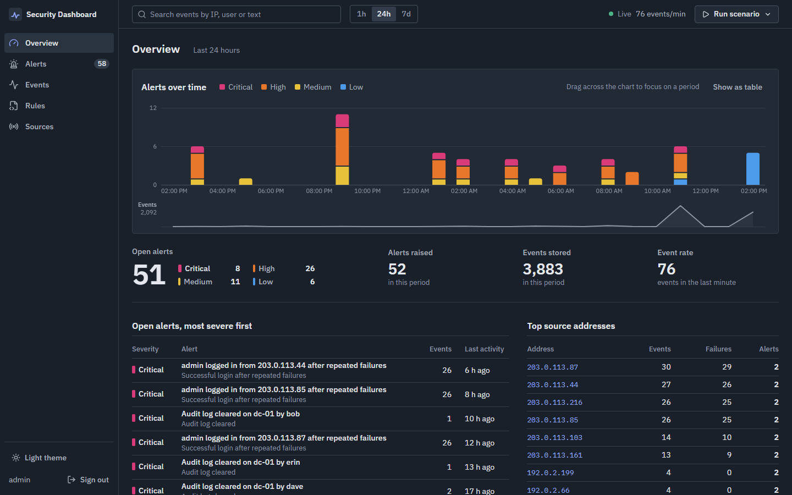
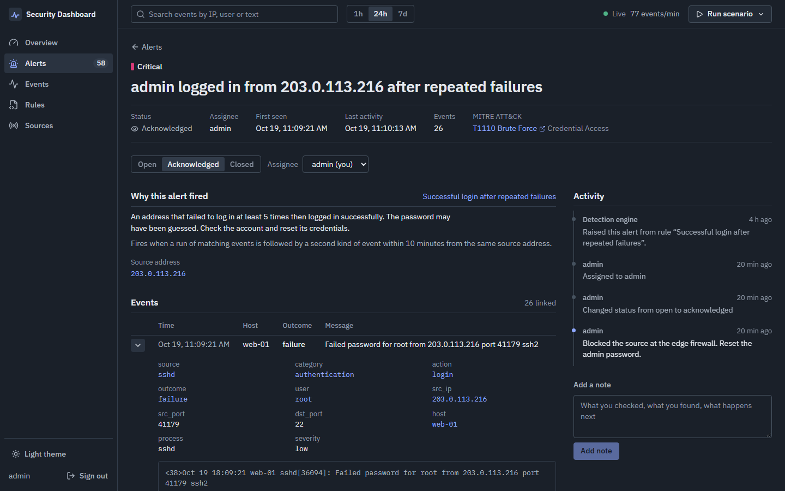
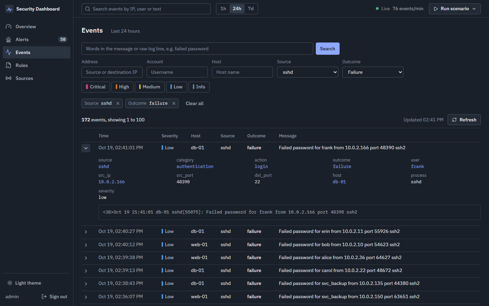
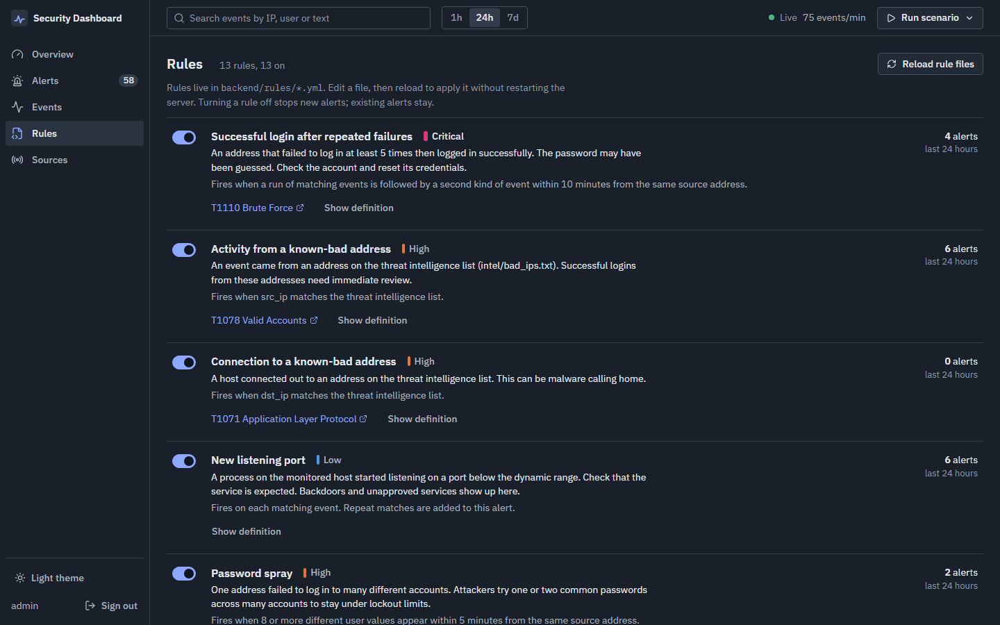

# Security Dashboard (SIEM)

A working security information and event management (SIEM) system, built as a CS project. It collects logs, stores and searches them, runs detection rules, and gives analysts a dashboard to triage the alerts.



## What it does

- **Collects logs** over UDP syslog, an HTTP API (JSON events or raw log lines) and a host agent that watches processes, listening ports and outbound connections on the SIEM machine.
- **Parses** syslog (RFC 3164 and 5424), OpenSSH, UFW/iptables, Apache/Nginx access logs and Windows Security events into one event schema, stored in SQLite with full-text search.
- **Detects** attacks with YAML rules of five kinds (match, threshold, distinct count, sequence, threat-intel match). Fourteen rules ship with it, each mapped to MITRE ATT&CK.
- **Raises alerts** that group repeat activity, link the events behind them and keep a history of status changes, assignment and notes.
- **Shows it all** in a React dashboard with live updates: an alert timeline you can drag across to focus on a period, an alert queue, alert investigation pages, event search with one-click pivots, rule management, source health and a Task Manager style Performance page for the SIEM's own machine (live CPU, per-core, memory, disk and network graphs, and top processes).
- **Blocks attackers** at the server firewall: block an address from an alert, an event or the Blocked page for 15 minutes to 7 days or permanently, or let chosen rules block the source of new alerts on their own. Blocks expire in the kernel, and your own address, internal networks and the server's addresses are always refused.
- **Simulates attacks** (SSH brute force, password spray, port scan, web attacks, privilege escalation, known-bad addresses) on top of ordinary background activity, so there is something to find.

| Alert investigation | Event search |
|---|---|
|  |  |



## Quick start

You need Python 3.12 or later and Node.js 20 or later. These steps build the dashboard once and run everything on one server at `http://127.0.0.1:5000`.

Windows PowerShell:

```powershell
cd frontend
npm install
npm run build
cd ..\backend
python -m venv venv
.\venv\Scripts\Activate.ps1
pip install -r requirements.txt
python server.py
```

macOS / Linux:

```sh
cd frontend && npm install && npm run build && cd ..
cd backend
python3 -m venv venv
source venv/bin/activate
pip install -r requirements.txt
python server.py
```

On the first start the server prints a generated password for the `admin` account (see [Analyst accounts](#analyst-accounts)). Open `http://127.0.0.1:5000` and sign in.

To work on the dashboard with hot reload, run the backend as above and use `npm run dev` in `frontend` instead of `npm run build`; see [Frontend](#frontend).

## A five-minute tour

1. **Sign in** as `admin` with the password from the server console.
2. **Run an attack.** Choose *Run scenario* in the top bar, then *SSH brute force*. Within a couple of seconds the Alerts count in the sidebar goes up and two alerts appear on the Overview: *SSH brute force* (high) and *Successful login after repeated failures* (critical).
3. **Read the timeline.** On the Overview, hover the columns of *Alerts over time*, then drag across a few of them. Every number on the page now covers only that period. Choose *Show all of the last 24 hours* to go back.
4. **Investigate.** Open the critical alert. *Why this alert fired* explains the rule in plain words, and the events list shows every failed password and the final successful login; expand one to see its raw log line.
5. **Pivot.** Select the source address under *Why this alert fired*. Event search opens with everything that address did. Expand an event and select another value, such as the account, to narrow further.
6. **Triage.** Back on the alert, choose *Acknowledged*, then *Assign to me*, and add a note. The activity history records each step.
7. **Tune.** On Rules, turn a rule off and run its scenario again: no new alert. Turn it back on.
8. **Check the plumbing.** Sources shows each log source, when it last sent anything, and how to point real devices at the SIEM.

Keyboard: in the alert list, `j` and `k` move, `x` selects and `Enter` opens. On the Overview chart, the arrow keys read each period and `Enter` focuses on it.

## How it fits together

```
 log sources                     backend (Flask, backend/siem)                       dashboard (React, frontend/src)
 ───────────                     ─────────────────────────────                       ───────────────────────────────
 UDP syslog :5514   ─┐
 POST /api/ingest   ─┼─▶ parsers ─▶ normalized event ─▶ SQLite (events + full-text index)
 host agent         ─┤                     │                                         Overview, Alerts, Events,
 attack simulator   ─┘                     ▼                                         Rules, Sources
                                  detection engine (backend/rules/*.yml)
                                           │                                         ▲
                                           ▼                                         │ REST + server-sent events
                                  alerts, notes, history ───────────────────────────┘
```

- `backend/siem/parsers/`: log formats. `pipeline.py`: the one path every event takes into storage.
- `backend/siem/detection/`: rule loading and the engine. Rules run on each new batch of events and look back over their time window in SQL, so nothing is lost on restart.
- `backend/siem/collectors/`: syslog listener and host agent. `simulator.py`: attack scenarios and background activity.
- `backend/siem/api/`: the REST API. `auth.py`: analyst accounts, sessions and CSRF protection. `web.py`: serves the built dashboard with security headers.
- `frontend/src/pages/`: one file per page. `components/`: shared pieces such as the alert chart and event table. `styles/tokens.css`: colors, type and spacing for both themes.

## Backend

The sections below cover running and configuring the backend on its own. The server listens on `http://127.0.0.1:5000` and stores events in `backend/data/siem.db` (SQLite).

### Analyst accounts

The dashboard and every read API need an analyst sign-in. On first start the server creates an account named `admin` and prints its generated password in the log:

```
WARNING siem.auth: Created analyst account 'admin' with password XXXXXXXXXXXXXXXX . Change it with: python manage.py set-password admin
```

To choose the first password yourself, set `SIEM_ADMIN_PASSWORD` before the first start. Manage accounts with:

```sh
python manage.py list-users
python manage.py create-user <username>
python manage.py set-password <username>
```

Passwords need at least 10 characters. After 10 failed sign-ins from one address in 5 minutes, that address is refused for 5 minutes. Every sign-in attempt is stored as an event (`source=siem`), so the detection rules watch the dashboard login too.

### Configuration

| Variable | Default | Purpose |
|---|---|---|
| `SIEM_DB_PATH` | `backend/data/siem.db` | SQLite database file |
| `SIEM_HOST` / `SIEM_PORT` | `127.0.0.1` / `5000` | Listen address |
| `SIEM_DEBUG` | `false` | Flask debug mode |
| `SIEM_CORS_ORIGINS` | `http://localhost:3000,http://127.0.0.1:3000` | Allowed dashboard origins, comma separated |
| `SIEM_INGEST_KEY` | `dev-ingest-key` | API key required by `POST /api/ingest` |
| `SIEM_RETENTION_DAYS` | `7` | Events older than this are deleted hourly |
| `SIEM_MAX_BATCH_SIZE` | `1000` | Maximum events or lines per ingest request |
| `SIEM_SYSLOG_HOST` / `SIEM_SYSLOG_PORT` | `127.0.0.1` / `5514` | UDP syslog listener. Port `0` turns it off. Use `0.0.0.0` to accept from other machines |
| `SIEM_HOST_AGENT` | `true` | Record processes, listening ports and outbound connections on this machine |
| `SIEM_HOST_AGENT_INTERVAL` | `10` | Seconds between host agent polls |
| `SIEM_SIMULATOR` | `true` | Enable attack scenarios and background activity |
| `SIEM_NOISE_RATE` | `0.5` | Ordinary background events per second. `0` turns it off |
| `SIEM_RULES_DIR` | `backend/rules` | Detection rule files |
| `SIEM_INTEL_DIR` | `backend/intel` | Threat intelligence lists (`<name>.txt`, one value per line) |
| `SIEM_ADMIN_USER` / `SIEM_ADMIN_PASSWORD` | `admin` / generated | First analyst account, created only when there are no accounts |
| `SIEM_SECRET_KEY` | generated | Signs session cookies. If unset, a key is generated and saved as `secret_key` next to the database |
| `SIEM_SESSION_HOURS` | `12` | How long a sign-in lasts |
| `SIEM_COOKIE_SECURE` | `false` | Send the session cookie over HTTPS only. Turn on when serving over HTTPS |
| `SIEM_STREAM_POLL_SECONDS` | `2` | How often the live stream checks for alert changes |
| `SIEM_STREAM_MAX_SECONDS` | `300` | The live stream closes after this; browsers reconnect automatically |
| `SIEM_FRONTEND_DIST` | `frontend/dist` | Built dashboard that Flask serves at `/`. Without a build, `/` explains how to make one |
| `SIEM_TRUST_PROXY` | `false` | Behind a reverse proxy (Caddy), take the client address and scheme from `X-Forwarded-For` / `X-Forwarded-Proto`. Only turn on behind a proxy |
| `SIEM_COOKIE_PATH` | `/` | Limit the session cookie to a path, e.g. `/siem` when served at `https://<domain>/siem/` |
| `SIEM_BLOCKLIST_FILE` | not set | Where the SIEM writes active blocks for the firewall sync. Not set: blocks are recorded but not enforced |
| `SIEM_BLOCK_ALLOWLIST` | empty | Extra addresses or ranges that may never be blocked, comma separated (CIDR) |
| `SIEM_PERF_INTERVAL` | `2` | Seconds between Performance page samples. One hour of samples is kept in memory |

Change `SIEM_INGEST_KEY` for anything other than local development.

### API

Access rules:

- `POST /api/ingest` and `POST /api/ingest/raw` need the `X-API-Key` header. They are for log senders, not people.
- `/api/health` and the demo login target are public.
- Everything else needs a signed-in analyst. Requests that change data (POST, PATCH) must also send the `X-CSRF-Token` header with the token returned at sign-in.

The examples use `curl`. In Windows PowerShell, type `curl.exe` instead of `curl`, because `curl` there is a different command. PowerShell versions of the common calls are at the end of this section.

**Sign in**:

```sh
curl -c cookies.txt -H "Content-Type: application/json" \
  -d '{"username":"admin","password":"<password>"}' http://127.0.0.1:5000/api/auth/login
# {"user": "admin", "csrf_token": "<token>"}
```

Send `-b cookies.txt` on later requests, and `-H "X-CSRF-Token: <token>"` on POST and PATCH requests. `GET /api/auth/me` returns the current analyst and token. `POST /api/auth/logout` signs out. `GET /api/auth/users` lists analyst names (for assigning alerts).

**Send events**: `POST /api/ingest` with header `X-API-Key`. The body is one event object or a list of them.

```sh
curl -X POST http://127.0.0.1:5000/api/ingest \
  -H "X-API-Key: dev-ingest-key" -H "Content-Type: application/json" \
  -d '{"source":"sshd","category":"authentication","action":"login","outcome":"failure",
       "severity":"low","user":"root","src_ip":"203.0.113.7",
       "message":"Failed password for root from 203.0.113.7 port 51234 ssh2"}'
```

Event fields:

| Field | Notes |
|---|---|
| `message` | Required, unless `raw` is given |
| `ts` | ISO 8601 or Unix epoch (seconds or milliseconds). Defaults to the time received |
| `severity` | `info` (default), `low`, `medium`, `high`, `critical` |
| `outcome` | `success`, `failure`, `unknown` (default) |
| `source`, `host`, `category`, `action`, `user`, `process` | Free text |
| `src_ip`, `dst_ip`, `src_port`, `dst_port` | Validated IP addresses and ports |
| `raw` | Original log line or object, kept for full-text search |

The response lists how many events were accepted and why any were rejected. Valid events in a batch are stored even if others fail.

**Send raw log lines**: `POST /api/ingest/raw` with header `X-API-Key` and a plain-text body, one line per log entry.

- `?format=` picks the parser: `auto` (default), `syslog`, `sshd`, `web`, `firewall`, `windows`.
- `?host=` sets the host for lines that do not name one.

```sh
curl -X POST "http://127.0.0.1:5000/api/ingest/raw?host=web-01" \
  -H "X-API-Key: dev-ingest-key" --data-binary @/var/log/auth.log
```

Supported formats in `auto` mode:

| Format | Example |
|---|---|
| Syslog (RFC 3164 and RFC 5424) | `<38>Oct 19 10:15:02 web-01 sshd[2211]: ...` |
| OpenSSH | `Failed password for root from 203.0.113.9 port 51022 ssh2` |
| UFW / iptables | `[UFW BLOCK] IN=eth0 SRC=203.0.113.9 DST=10.0.1.10 PROTO=TCP DPT=3389` |
| Apache / Nginx access log | `203.0.113.9 - - [19/Oct/2026:10:15:02 +0000] "GET / HTTP/1.1" 200 312` |
| Windows Security events as JSON | `{"EventID": 4625, "Computer": "dc-01", "TargetUserName": "bob", ...}` |

Lines that match no format are kept with `category` set to `unknown`. Syslog lines without a year or time zone are read as UTC.

`POST /api/ingest` also accepts Windows event objects (with `EventID`) and `{"format": "sshd", "raw": "<line>"}` items.

**Send syslog**: point rsyslog, a firewall or a router at UDP port 5514. For example, in `/etc/rsyslog.d/90-siem.conf`:

```
*.* @<siem-host>:5514
```

**Search events**: `GET /api/events`

| Parameter | Meaning |
|---|---|
| `q` | Full-text search over `message` and `raw`. Every word must match, as a prefix |
| `from`, `to` | Time range (ISO 8601 or epoch) |
| `severity` | One or more levels, comma separated |
| `source`, `host`, `category`, `action`, `outcome`, `user`, `src_ip`, `dst_ip` | Exact match |
| `ip` | Matches either `src_ip` or `dst_ip` |
| `limit`, `page` | Pagination (default 50 per page, maximum 500) |

`GET /api/events/<id>` returns one event.

**Simulate attacks**: `GET /api/simulate` lists the scenarios. `POST /api/simulate/<id>` runs one.

| Scenario | What it generates |
|---|---|
| `brute_force` | Many failed SSH passwords from one address, then a successful login |
| `password_spray` | One password tried against many Windows accounts |
| `port_scan` | About 60 ports probed in under 20 seconds |
| `web_attack` | SQL injection, path traversal, XSS and command injection requests |
| `privilege_escalation` | New account added to Administrators, then the audit log is cleared |
| `known_bad_ip` | A successful SSH login from an address in `backend/intel/bad_ips.txt` |

The simulator uses documentation (RFC 5737) and private IP ranges only. While the server runs, it also writes ordinary background activity, so attacks appear among normal events.

**Alerts**: `GET /api/alerts` lists alerts, newest activity first.

| Parameter | Meaning |
|---|---|
| `status` | `open`, `acknowledged`, `closed`; comma separated |
| `severity` | One or more levels, comma separated |
| `rule_id` | Alerts from one rule |
| `assignee` | Alerts assigned to one analyst. Empty (`assignee=`) means unassigned |
| `q` | Text in the title or group (for example an IP address) |
| `from`, `to` | Time range, matched against the alert's activity |
| `sort` | `recent` (default, latest activity first), `severity` (most severe first) or `oldest` |
| `limit`, `page` | Pagination |

- `GET /api/alerts/<id>` returns one alert with its events and notes. Notes include analyst comments (`kind: comment`) and a history of status and assignee changes (`kind: change`).
- `PATCH /api/alerts/<id>` with `{"status": "acknowledged", "assignee": "admin"}` changes either or both. Send `"assignee": null` to unassign.
- `POST /api/alerts/bulk` with `{"ids": [1, 2, 3], "status": "closed"}` changes many alerts at once.
- `POST /api/alerts/<id>/notes` with `{"body": "Blocked at the firewall."}` adds a comment.

New activity for a closed alert opens a new alert.

**Rules**:

- `GET /api/rules` lists detection rules, whether each is enabled, and how many alerts each raised in the last 24 hours.
- `PATCH /api/rules/<id>` with `{"enabled": false}` turns a rule off or on.
- `POST /api/rules/reload` re-reads the rule and intel files without a restart. If a file is invalid, the response names it and the previous rules stay active.

**Overview**: `GET /api/stats/overview?range=24h` (`1h`, `24h` or `7d`) returns alerts and events per time bucket for the whole range. Totals, open alerts by severity, top source addresses, top rules and accounts with the most failed logins cover the whole range too, or only `from`–`to` when those are given (the dashboard sends them when you drag across the alert chart).

**Performance**: `GET /api/performance?since=<epoch ms>` returns the machine's facts, current disks, load and top processes, and the CPU, memory, disk and network samples taken after `since` (up to one hour). `GET /api/system-health` returns current CPU, memory and disk percentages. Both need a sign-in.

**Blocking**:

- `GET /api/blocks` returns active blocks, ended blocks and whether a firewall is enforcing them.
- `POST /api/blocks` with `{"ip": "203.0.113.9", "minutes": 60, "reason": "...", "alert_id": 12}` blocks an address. `minutes` is 15, 60, 1440, 10080 or `null` for permanent. Blocking an address that is already blocked extends it. Refused, with the reason, for your own address, internal networks, the server's addresses and the allowlist.
- `POST /api/blocks/<id>/unblock` ends a block.
- `PATCH /api/rules/<id>` with `{"auto_block_minutes": 60}` (15, 60, 1440 or `null`) makes a rule block the source address of each new alert. Only for rules that group by `src_ip`. Addresses that signed in to the SIEM in the last 24 hours are never auto-blocked.

Every block and unblock is stored as an event (`category=response`), and blocks started from an alert are noted in its history.

**Sources**: `GET /api/sources` lists each log source and host seen in the last 24 hours, with event counts and the last event time. It also reports how logs reach the SIEM (syslog address, host agent, simulator, and whether the ingest key is still the default; the key itself is never returned).

**Live updates**: `GET /api/stream` is a [server-sent events](https://developer.mozilla.org/docs/Web/API/Server-sent_events) stream. It sends an `alert` event when an alert is created or changes, and a `stats` event every 5 seconds with the event rate and the number of open alerts.

**Demo login target**: `POST /api/demo/login` sleeps briefly, fails 10% of the time and records each attempt as an event.

**PowerShell examples**:

```powershell
$api = "http://127.0.0.1:5000/api"
$login = Invoke-RestMethod -Method Post "$api/auth/login" -SessionVariable siem `
  -ContentType "application/json" -Body '{"username":"admin","password":"<password>"}'
$csrf = @{ "X-CSRF-Token" = $login.csrf_token }

# Run an attack scenario, then list the alerts it raised
Invoke-RestMethod -Method Post "$api/simulate/brute_force" -WebSession $siem -Headers $csrf
(Invoke-RestMethod "$api/alerts" -WebSession $siem).alerts | Format-Table id, severity, rule_id, title

# Acknowledge alert 1 and assign it to yourself
Invoke-RestMethod -Method Patch "$api/alerts/1" -WebSession $siem -Headers $csrf `
  -ContentType "application/json" -Body '{"status":"acknowledged","assignee":"admin"}'

# Send an event (API key, no sign-in)
Invoke-RestMethod -Method Post "$api/ingest" -Headers @{ "X-API-Key" = "dev-ingest-key" } `
  -ContentType "application/json" -Body '{"message":"test event","src_ip":"203.0.113.7"}'
```

### Detection rules

Every stored event is checked against the rules in `backend/rules/`. When a rule matches, the SIEM raises an alert and links the events that caused it. Matching events for the same rule and group (for example the same source IP) are added to the existing open alert instead of creating a new one.

| Rule | Type | Severity | MITRE ATT&CK |
|---|---|---|---|
| SSH brute force | threshold: 10 failures per address in 2 minutes | high | T1110.001 |
| Successful login after repeated failures | sequence: 5 failures, then a success, in 10 minutes | critical | T1110 |
| Password spray | distinct: 8 accounts per address in 5 minutes | high | T1110.003 |
| Port scan | distinct: 25 ports per address in 1 minute | medium | T1046 |
| Web application attack | match | high | T1190 |
| Vulnerability scanner | match on user agent | medium | T1595.002 |
| Activity from / connection to a known-bad address | ioc on `intel/bad_ips.txt` | high | T1078, T1071 |
| New user account | match | medium | T1136.001 |
| Member added to an admin group | match | high | T1098 |
| Audit log cleared | match | critical | T1070.001 |
| Hidden or encoded PowerShell | match | high | T1059.001 |
| New listening port (host agent) | match | low | |
| Dashboard sign-in guessing | threshold: 10 failed SIEM sign-ins per address in 5 minutes | high | T1110.001 |

A rule file holds one rule or a list of rules:

```yaml
id: ssh-brute-force                 # lowercase letters, digits and dashes
name: SSH brute force
description: Many failed SSH logins from one address in a short time.
severity: high                      # info, low, medium, high, critical
type: threshold                     # match, threshold, distinct, sequence, ioc
where:
  source: sshd                      # exact match
  action: [login, invalid_user]     # a list matches any value
  message|contains: password        # also: startswith, endswith, regex, gt, gte, lt, lte
group_by: [src_ip]
window: 2m                          # 30s, 5m, 1h, 1d
threshold: 10
dedupe: 10m                         # optional; default is the window or 10 minutes, whichever is longer
title: "SSH brute force from {src_ip}"
mitre: {tactic: Credential Access, technique: T1110.001, name: Password Guessing}
```

- `distinct` rules also need `field`: the alert fires when that field has `threshold` different values.
- `sequence` rules use `steps` instead of `where`: two steps, the first with a `count`, for the same group within `window`.
- `ioc` rules need `field` and `list`, the name of a file in the intel directory without `.txt`.

The server checks every rule file at startup. An invalid file stops startup with a message naming the file and the problem. After editing rules, choose *Reload rule files* on the Rules page (or `POST /api/rules/reload`); if a file is invalid, the previous rules stay active and the page shows the error.

### Tests

```sh
cd backend
python -m pytest
```

## Frontend

Requires Node.js 20 or later. For day-to-day work on the dashboard, start the backend first, then in a second terminal:

```sh
cd frontend
npm install
npm run dev
```

Open `http://localhost:3000` and sign in with your analyst account.

The dev server forwards `/api` requests to the backend at `http://127.0.0.1:5000`, so the browser talks to one address and the sign-in cookie works. To use a backend on another address, set `SIEM_BACKEND_URL` before `npm run dev`:

```powershell
$env:SIEM_BACKEND_URL = "http://127.0.0.1:5055"; npm run dev
```

| Command | What it does |
|---|---|
| `npm run dev` | Development server with hot reload on port 3000 |
| `npm test` | Run the frontend tests (Vitest) |
| `npm run build` | Production build in `frontend/dist`, which the backend then serves at `http://127.0.0.1:5000` |
| `npm run preview` | Serve the production build on port 3000, with the same `/api` forwarding |

The interface uses IBM Plex Sans and IBM Plex Mono, bundled with the app (no external font requests). It follows the system light or dark setting until you choose a theme in the sidebar.

## Deploying behind Caddy

The SIEM can sit next to other sites on an existing Caddy server, at a path such as `https://<domain>/siem/`. The SIEM's own sign-in protects it. The files are in `deploy/`.

1. **Build the dashboard for the path** on your laptop: `cd frontend; npm run build:siem`. This writes `frontend/dist` with every link under `/siem/`.
2. **Install on the server** (Ubuntu shown; the SIEM needs Python 3.11 or later):
   ```sh
   sudo adduser --system --group --home /var/lib/siem siem
   sudo mkdir -p /opt/siem /etc/siem
   # copy backend/ and frontend/dist/ to /opt/siem (scp or rsync)
   python3.12 -m venv /opt/siem/backend/venv
   /opt/siem/backend/venv/bin/pip install -r /opt/siem/backend/requirements.txt
   ```
3. **Configure**: copy `deploy/siem.env.example` to `/etc/siem/siem.env`, replace the three secrets, then `sudo chmod 600 /etc/siem/siem.env && sudo chown siem: /etc/siem/siem.env`.
4. **Run it as a service**: copy `deploy/siem.service` to `/etc/systemd/system/`, then `sudo systemctl enable --now siem`. It listens on `127.0.0.1:5050` only, under the waitress server, as one process.
5. **Add it to Caddy**: paste `deploy/Caddyfile.siem` into the site block, then `caddy validate --config /etc/caddy/Caddyfile` and `sudo systemctl reload caddy`. For an extra password in front of the sign-in page, the file explains how to add Caddy `basic_auth`.
6. **Blocking at the firewall**: the SIEM writes active blocks to a file; a root-run sync turns them into an nftables set whose entries expire on their own. The SIEM itself never gets root.
   ```sh
   sudo install -m 755 /opt/siem/deploy/siem_firewall_sync.py /usr/local/sbin/siem-firewall-sync
   sudo install -m 644 /opt/siem/deploy/siem-firewall.service /opt/siem/deploy/siem-firewall.path /etc/systemd/system/
   echo "SIEM_BLOCKLIST_FILE=/var/lib/siem/blocklist.json" | sudo tee -a /etc/siem/siem.env
   sudo systemctl daemon-reload && sudo systemctl enable --now siem-firewall.path siem-firewall.service
   sudo systemctl restart siem
   ```
   List addresses that must never be blocked (the server's own, your usual ones) in `/etc/siem/never-block.conf`, one per line. To undo: `sudo systemctl disable --now siem-firewall.path siem-firewall.service && sudo nft delete table inet siem`. If you ever lock yourself out, use your provider's web console and run `sudo nft flush set inet siem blocked4`.
7. **Optional, real data**: copy `deploy/rsyslog-siem.conf` to `/etc/rsyslog.d/90-siem.conf` and `sudo systemctl restart rsyslog`. The server's SSH logins and failures then flow into the SIEM.

For later updates, build again, copy the new files over and run `deploy/update.sh` on the server.

## Security notes

- Change `SIEM_INGEST_KEY` and the generated `admin` password before exposing the server to a network. Sources in the dashboard warns while the default ingest key is in use.
- Sign-in uses an HttpOnly, SameSite=Lax session cookie and a CSRF token on every change. Turn on `SIEM_COOKIE_SECURE` behind HTTPS.
- Pages are served with a Content Security Policy that allows only the dashboard's own scripts, fonts and API, plus `X-Frame-Options: DENY` and `nosniff`.
- `python server.py` uses Flask's development server. For a shared deployment, run the app under a production WSGI server behind HTTPS.
- The simulator only uses documentation (RFC 5737) and private IP ranges.

## Accessibility

The dashboard was checked with axe-core (WCAG 2.2 A and AA rules) on every page in both themes, with no violations, and walked with the keyboard alone. Chart text was checked by hand at 4.9:1 contrast or better. Severity is always shown as text next to its color, every chart has a table view, and motion is reduced when the system asks for it.
